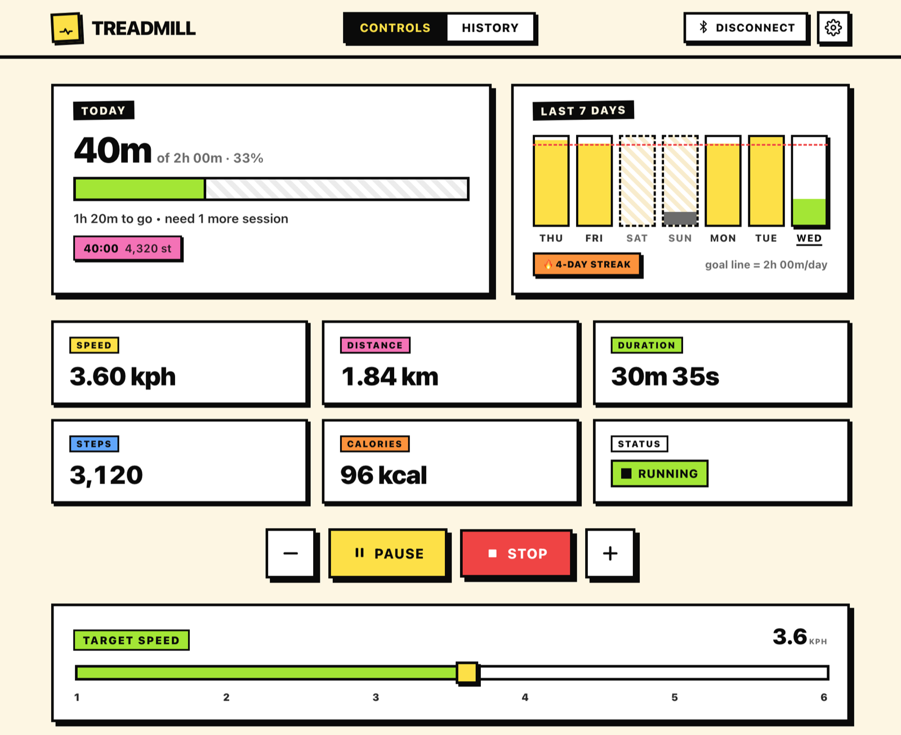

# Treadmill

A browser dashboard that talks to your PitPat walking pad directly over Bluetooth. Open the page, click Connect, walk.



## Why this exists

The stock app wants an account, your phone number, a notification permission to advertise at you, and 200 MB of your storage. This is one HTML file plus three small scripts. No account. No server. No telemetry. It makes no third-party requests; your walks live in your own browser's storage — yours, exportable, gone the moment you say so.

## What it does

- **Live readout.** Speed, distance, duration, steps, calories and belt state, updated with every Bluetooth notification.
- **Speed control.** 1–6 km/h slider plus ±0.1 buttons. Slider and buttons stay in sync; whichever you touch wins.
- **Daily goal.** Pick minutes per day. Today's progress, a 7-day bar chart and a weekday streak (weekends optional). A minimum session length makes two real walks count, not one long one plus a few seconds.
- **Auto-logged history.** Every walk is recorded as it happens. Pausing keeps the walk going, and stopping and restarting within 60 s continues it instead of starting a new one.
- **Export / import.** Back up your history as JSON. Importing *merges* into what is already there, so you can combine walks from two computers.
- **Smart reminders.** Notifications when you've been at the desk for an hour, when the day is slipping past with the goal unmet, and at 25 / 50 / 75 / 100 %. Quiet on weekends (optional), outside your active hours, and while you're walking.
- **Stays awake.** While the belt runs and the app is on screen, it keeps the display from sleeping, so a dozing laptop doesn't drop the connection mid-walk.
- **Installable.** Install it as an app and it gets its own window and Dock / taskbar icon, and works offline.

## Browser support

The app uses [Web Bluetooth](https://developer.mozilla.org/en-US/docs/Web/API/Web_Bluetooth_API), which only Chromium-based browsers ship.

| | Works |
|---|---|
| Chrome, Edge, Arc — macOS, Windows, Linux, ChromeOS, Android | ✅ |
| Brave | ✅ after enabling `brave://flags/#brave-web-bluetooth-api` (off by default) |
| Safari (macOS, iOS), Firefox, any browser on iPhone / iPad | ❌ no Web Bluetooth |

The page tells you when the current browser can't connect.

## Get going

1. Open the app in Chrome (or another browser from the table above).
2. Click **Connect** in the header.
3. Pick your treadmill in the Bluetooth prompt.
4. Hit **Start**.

### On a Mac

- **Install it as an app** (optional, recommended): in Chrome click the install icon in the address bar, or open the **⋮** menu → **Cast, save and share** → **Install page as app…**; in Edge, **Apps → Install this site as an app**. It then lives in Launchpad, Spotlight and the Dock like any other app.
- **Bluetooth permission:** macOS asks once whether Chrome may use Bluetooth. If you said no, or Connect reports that Bluetooth is unavailable, turn it on under **System Settings → Privacy & Security → Bluetooth**, then restart the browser.
- **Notifications:** for reminders, allow notifications when the app asks, and make sure the browser is allowed under **System Settings → Notifications**.
- **Desk-time reminders** need one more permission, *"know when you're actively using this device"*. Without it the app only sees activity inside its own window, so it can't tell that you've been typing in another app for an hour. It is requested together with notifications; if you already enabled reminders, open **Settings → Detect activity in other apps**.

Reminders are checked while the app is open; a background tab or a minimised app window is enough.

### Moving to a new computer

Your history is stored per browser. On the old machine open **History → Export**, on the new one **History → Import**. Walks that already exist on the new machine are kept; nothing is overwritten.

## Run it locally

Any static file server works. Web Bluetooth and the service worker need `https://` or `http://localhost`, so don't open `index.html` straight from disk.

```bash
python3 -m http.server 8642
```

Then open <http://localhost:8642>. Use a port you don't use for other projects: the service worker takes over everything on that origin.

Add `?debug` to the URL (or set `localStorage.treadmill_debug = '1'`) to log every Bluetooth packet to the console.

## Deploy to GitHub Pages

The workflow in [.github/workflows/pages.yml](.github/workflows/pages.yml) checks the scripts and publishes the app files (not the README or other repo files) on every push to `main`.

1. Push the repository to GitHub.
2. In the repository, open **Settings → Pages** and set **Source** to **GitHub Actions**.
3. Push to `main` (or run the workflow by hand from the **Actions** tab). The app appears at `https://<user>.github.io/<repo>/`.

All paths are relative, so the app works from a sub-path like that without changes.

## How it works

| File | Purpose |
|---|---|
| `index.html` | Markup and styles |
| `treadmill.js` | Bluetooth connection, packet parsing, controls, session recording, history |
| `goals.js` | Daily goal, 7-day chart, streak, settings |
| `notifications.js` | Reminder logic and activity detection |
| `sw.js` | Offline cache and background reminder checks |

**Protocol.** The treadmill exposes service `0000fba0-…`, notifies on characteristic `fba2` and accepts writes on `fba1`. Each notification (≥ 31 bytes, big-endian) carries speed (`u16` at byte 3, ×1000), distance (`u32` at 7), steps (`u32` at 14), calories (`u16` at 18), elapsed time in ms (`u32` at 20) and a flags byte at 26 (bit 7: imperial units, bits 3–4: starting / running / paused / stopped). The app answers every notification with either a queued command or a heartbeat (`6a 05 fd f8 43`). Commands are 23-byte packets starting `6a 17`, carrying target speed and a start / pause / stop code, with an XOR checksum over bytes 1–20 and a trailing `43`.

**Data.** Sessions are stored in `localStorage` under `treadmill_sessions`, newest first: `{ date, duration, steps, calories, avgSpeed, speedUnit }`, with `date` as a Unix timestamp in ms and `duration` in seconds. A copy goes to IndexedDB so the service worker can read it.

## Safety

This is an unofficial, reverse-engineered controller, not affiliated with PitPat or its manufacturer. Keep the treadmill's own remote or stop button within reach and don't rely on this page to stop the belt.

## License

Public domain under [The Unlicense](LICENSE).
